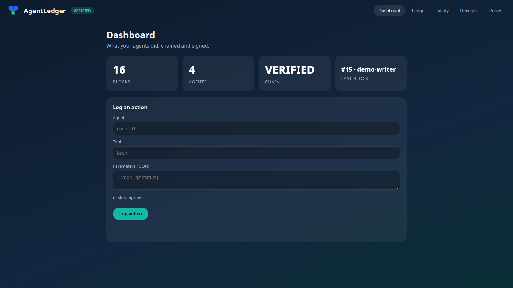

<p align="center"></p>

# AgentLedger (MeshVeritas)

**Every agent action, chained and signed — prove what your agents did.**

[](LICENSE)
[](https://www.python.org/downloads/)
[]()

AI agents run shell commands, call APIs, query databases and move money. Normal
logs can be edited by the same agent that made the mistake. AgentLedger is a
small, zero-dependency Python ledger that makes those actions tamper-evident:

- Each action is appended as a block linked to the previous block with SHA-256.
  Change any old action and verification fails.
- Each block is signed with an HMAC key that lives in a per-ledger key file
  (`<ledger>.key`, mode 0600) created when you initialise the ledger — or in
  the `AGENT_LEDGER_KEY` environment variable. There is no built-in key.
- A policy guard runs **before** an action is recorded: dangerous actions are
  blocked (and the refusal itself is recorded), sensitive actions need an
  explicit approval, and everything else passes.
- A real Merkle root over all block hashes lets you prove one action is in
  the ledger without handing over the whole file.

## The GUI



*The dashboard above uses the seeded demo ledger (`tools/seed_demo.py`) — fake data only.*

```bash
agent-ledger serve --path ~/.agent-ledger/ledger.jsonl --port 8765
# open http://127.0.0.1:8765
```

Five screens: Dashboard · Ledger · Verify · Receipts · Policy. The GUI binds
to localhost by default and has no login — keep it on localhost, or on a
network you trust.

## Quickstart

```bash
git clone https://github.com/satiralabs/agent-ledger.git
cd agent-ledger
pip install -e .
# or run without installing:
./bin/agent-ledger --help
```

```bash
agent-ledger init                                   # ledger + key file
agent-ledger log --agent coder-01 --action tool_call \
  --payload '{"tool": "bash", "cmd": "git status"}'
agent-ledger verify                                 # chain + signatures
agent-ledger audit --agent coder-01 --limit 20      # filter by agent/action/--since
agent-ledger root                                   # Merkle root
agent-ledger prove --block 0                        # inclusion proof (JSON)
agent-ledger prove --block 0 --verify               # check a proof
agent-ledger export --out ./audit-bundle --zip      # hand-off pack for an auditor
```

`--path` works before or after the subcommand:
`agent-ledger log --path /tmp/demo.jsonl …` is fine.

### Policy, in practice

```bash
$ agent-ledger log --agent ops-01 --action tool_call \
    --payload '{"tool": "bash", "cmd": "rm -rf /"}'
BLOCKED by policy: Prohibited dangerous pattern 'rm -rf' detected in parameters
Refusal recorded as Block #1 (policy_block)     # exit code 3

$ agent-ledger log --agent ops-01 --action tool_call \
    --payload '{"tool": "bank", "op": "transfer 50"}'
APPROVAL REQUIRED: …                            # exit code 4
# add --approve to record it, stored as a wrapper:
# {"approved": true, "policy_status": "APPROVAL_REQUIRED", "data": {…original…}}

$ agent-ledger policy-check --tool bash --params '{"cmd": "git status"}'
PASS: Action authorized under policy
```

Costs are enforced too: a `cost_usd` (or `cost` / `amount_usd` / `price_usd`)
in the parameters above the policy limit ($5 by default) needs approval.

### Receipts

A receipt is signed proof of one prompt → one tool → one result:

```bash
agent-ledger receipt --agent researcher-02 \
  --prompt "Summarise user financial statements" \
  --model claude-3-5-sonnet --tool sql_query \
  --params '{"query": "SELECT balance FROM accounts"}' \
  --result '{"balance": 15400}' --append
```

Without `--append` the receipt is only printed. With `--append` it is stored
in the ledger, linked to the current head block automatically.

## Use it from Python (3 lines)

```python
from agent_ledger.helper import LedgerSession
session = LedgerSession("~/.agent-ledger/ledger.jsonl", agent_id="coder-01")
block = session.log("bash", {"cmd": "git status"}, result={"ok": True})
```

Policy applies here too — a blocked call raises `PolicyBlocked` after the
refusal is recorded. See `agent_ledger/helper.py` for the context-manager form.

## Use it from an MCP agent

```bash
agent-ledger-mcp --path ~/.agent-ledger/ledger.jsonl
```

A stdio JSON-RPC MCP server (standard library only) with tools:
`ledger_log`, `ledger_verify`, `ledger_audit`, `ledger_receipt`,
`ledger_root`, `ledger_prove`, `policy_check`.

## Security notes

- **Keep the key file secret.** Whoever holds `<ledger>.key` (or
  `AGENT_LEDGER_KEY`) can sign blocks and receipts that verify. Losing it
  means new signatures cannot be checked against old ones.
- **Tamper-evident is not tamper-proof.** Anyone with write access to both
  the ledger and the key can rewrite history and re-sign it. Keep backups of
  the ledger (and its Merkle root) somewhere the agents cannot write.
- **Policy is a guardrail, not a sandbox.** AgentLedger records and refuses
  at the point of logging; it does not execute or contain the tool call.
- **Unsigned blocks** appear when no key is available at log time. The CLI
  warns loudly in that case; `verify` counts signed and unsigned separately.

## Threat model

| Attack | Defence |
|---|---|
| Log forgery / deletion | SHA-256 hash chain + Merkle root; silent edits break verification |
| Prompt-injection cover-up | Prompt hash is signed into the receipt before results exist |
| Dangerous action executed quietly | Policy blocks it and records the refusal as its own block |
| Replay / reordering | Strictly increasing block indices and prev-hash links |

## Docs

- [Developer guide](docs/DEVELOPER.md) — architecture, file formats, internals
- [User manual](docs/USER-MANUAL.md) — plain-language, step by step

## License

MIT. Created by Susan (Abenezer) at SatiraLabs.
